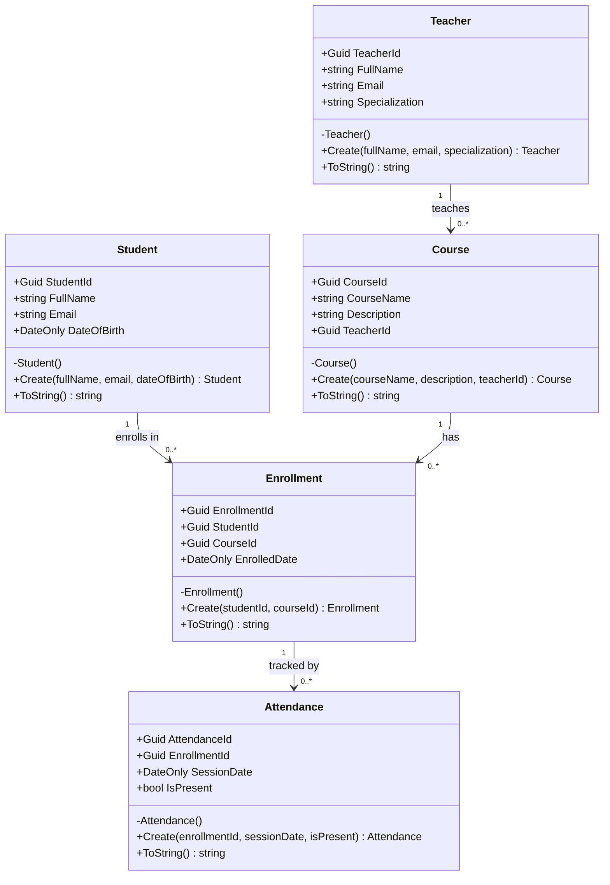

# EduHub – Bài Tập Ch01

> **Môn:** IN4211 – Phát triển phần mềm hướng đối tượng  
> **Chủ đề:** Phân tích yêu cầu & Domain Modeling EduHub  
> **Điểm:** 100 điểm – HĐ1.3

---

## 1 · User Stories 

### 👤 Student (Sinh viên)

**Story 1 – Đăng ký khoá học**
> As a **student**, I want to **enroll in a course**, so that **I can start learning and tracking my progress**.

- AC1: Hệ thống cho phép đăng ký khi khoá học còn đang mở.
- AC2: Sau khi đăng ký thành công, sinh viên nhận xác nhận với tên khoá học và ngày đăng ký.
- AC3: Hệ thống từ chối nếu sinh viên đã đăng ký khoá học đó trước đó.

**Story 2 – Xem lịch sử điểm danh**
> As a **student**, I want to **view my attendance record**, so that **I can monitor my participation and avoid being disqualified**.

- AC1: Hiển thị danh sách buổi học với trạng thái "Có mặt" / "Vắng".
- AC2: Hiển thị tỉ lệ tham dự (%) và cảnh báo khi dưới 80%.

---

### 👤 Teacher (Giáo viên)

**Story 3 – Ghi nhận điểm danh**
> As a **teacher**, I want to **record attendance for each student per session**, so that **I can track who participates in class**.

- AC1: Giáo viên đánh dấu từng sinh viên "Có mặt" hoặc "Vắng" theo buổi học cụ thể.
- AC2: Hệ thống không cho phép ghi điểm danh cho buổi học trong tương lai.

**Story 4 – Xem báo cáo tham dự**
> As a **teacher**, I want to **view an attendance report for my course**, so that **I can identify students at risk of failing**.

- AC1: Báo cáo hiển thị tên, số buổi có mặt, tổng số buổi và tỉ lệ (%).
- AC2: Sinh viên dưới 80% được đánh dấu cảnh báo riêng.

---

### 👤 Admin (Quản trị viên)

**Story 5 – Tạo và quản lý khoá học**
> As an **admin**, I want to **create a course and assign it to a teacher**, so that **students can enroll in structured learning programs**.

- AC1: Admin tạo khoá học với tên (≥ 3 ký tự), mô tả và giáo viên phụ trách.
- AC2: Hệ thống từ chối nếu tên trùng hoặc không có giáo viên hợp lệ.

---

## 2 · Sơ đồ lớp 



### Khoá ngoại

| Khoá ngoại | Nằm trong class | Tham chiếu tới |
|---|---|---|
| `TeacherId` | `Course` | `Teacher.TeacherId` |
| `StudentId` | `Enrollment` | `Student.StudentId` |
| `CourseId` | `Enrollment` | `Course.CourseId` |
| `EnrollmentId` | `Attendance` | `Enrollment.EnrollmentId` |

---

## 3 · Domain Classes 

Xem thư mục [`Domain/`](./Domain):

| File | Class |
|---|---|
| [`Domain/Student.cs`](./Domain/Student.cs) | Student |
| [`Domain/Teacher.cs`](./Domain/Teacher.cs) | Teacher |
| [`Domain/Course.cs`](./Domain/Course.cs) | Course |
| [`Domain/Enrollment.cs`](./Domain/Enrollment.cs) | Enrollment |
| [`Domain/Attendance.cs`](./Domain/Attendance.cs) | Attendance |

**Pattern áp dụng trên mỗi class:**
```csharp
public class Student
{
    public Guid StudentId { get; private set; }   // private set
    public string FullName { get; private set; } = string.Empty;

    private Student() { }                          // constructor private

    public static Student Create(...)              // factory method Create()
    {
        if (string.IsNullOrWhiteSpace(fullName))
            throw new ArgumentException("...");    // validation
        return new Student { ... };
    }
}
```

---

## 4 · Console Demo 

Xem [`Program.cs`](./Program.cs) – chạy đủ các luồng:

1. Tạo giáo viên
2. Tạo khoá học (FK: TeacherId)
3. Tạo sinh viên
4. Đăng ký học (FK: StudentId, CourseId)
5. Ghi điểm danh 3 buổi (FK: EnrollmentId)
6. **In báo cáo tham dự** – tên, số buổi, tỉ lệ %, trạng thái
7. Kiểm tra validation – bắt `ArgumentException`

**Chạy thử:**
```bash
dotnet run
```

---

## 5 · Git và PR 

Commits theo [Conventional Commits](https://www.conventionalcommits.org/):

```
chore: khoi tao project EduHub .NET 8
feat:  them 5 domain classes voi factory method va validation
feat:  them console demo chay du luong nghiep vu va bao cao tham du
docs:  them README voi user stories va so do lop
```
